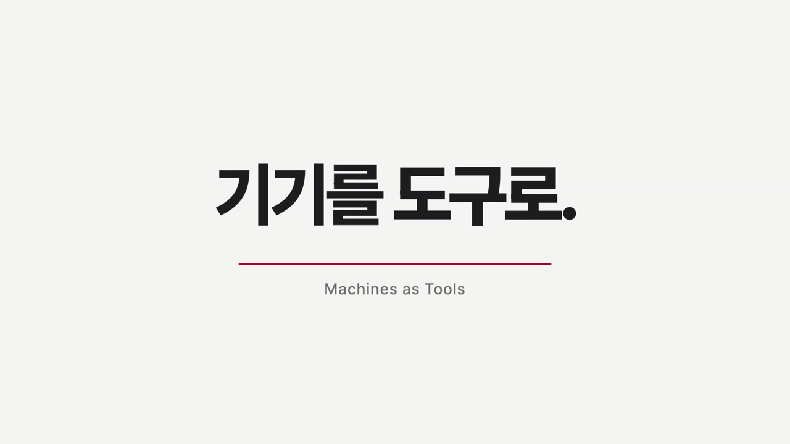

# machines-as-tools — 기기를 도구로

> **English summary.**
> Three Macs cannot run one Claude Code session at the same time: a session is a single process appending to a single transcript.
> But Claude's reasoning runs on the server, and what actually eats a machine's RAM is the *tools* the session drives — browsers, builds, renders, scans.
> So this repo keeps **one session in charge** and registers spare Macs as **MCP tools** (19 of them, served by an MCP server called `multimac` on top of a shell wrapper `mm`).
> The rule of thumb is a cost ladder: deterministic shell work first (no LLM), a cheap lean worker with a short brief second, a stronger model third, and a full conversation fork only as a last resort.
> Measured on a laptop (M5 Max 128GB), an always-on home Mac (M3 Max 64GB) and a MacBook Air (M2 8GB), 2026-10-08 to 10-09; dollar figures are API-price equivalents.
>
> | Measurement | Before → After |
> |---|---|
> | Same summarization task: full conversation fork → ~1,000-char brief + Haiku worker | $2.14 → $0.0146 (about 147×) |
> | Fan-out to 3 Macs: Workflow proxy agents → `mm batch` | 36 s, ~220k proxy tokens → 6.2 s, 0 proxy tokens |
> | Remote worker context: default config → lean config | 95,209 → 26,934 tokens ($0.3119 → $0.0283) |
> | ssh round trip: new connection → ControlMaster reuse | 0.2–0.3 s → 0.04 s |

---

## 한 줄

**에이전트를 늘리기 전에, 기기를 도구로.** 세션은 하나로 두고, 남는 기기는 그 세션의 도구로 등록한다.

## 영상 (71초)

[](media/machines-as-tools_71s.mp4)

[media/machines-as-tools_71s.mp4](media/machines-as-tools_71s.mp4) — 71초짜리 한국어 컨셉 영상이다. 음악과 효과음이 깔리고 내레이션은 없다. 개인용 비공개 영상 킷(motion-reel)으로 만들었고, 리뷰어 두 명이 따로 검토한 뒤 고쳐서 품질 게이트를 통과했다. 이 영상도 이 저장소의 render 도구로 홈맥에서 렌더했다.

## 왜 만들었나

나는 노트북 한 대에 Claude Code 프로세스를 100개 넘게 띄워 두고 일한다. 그러다 무거운 작업을 한 기기에서 겹쳤다. 영상 렌더 워커 8개(약 9GB)와 병렬 `claude -p` 여러 개를 함께 돌렸고, 그 결과 커널 패닉을 두 번(2026-06-19, 2026-09-27) 겪었다. 그동안 집에 있는 64GB 맥과 맥북에어는 거의 놀고 있었다.

마침 공개 오픈소스 [OpenRig](https://github.com/mvschwarz/openrig)를 분석하고 있었다. OpenRig 는 Claude Code·Codex 세션 여러 개를 tmux 위에 팀으로 상주시키는 데몬이다. 그걸 보다가 질문이 생겼다.

> 맥 세 대가 Claude Code 세션 하나를 실시간으로 같이 쓰면서 일을 나눠 맡을 수 있나? 각자 RAM 을 따로 쓰면서, 어떤 기기는 브라우저 조작, 어떤 기기는 다른 일을.

말로 판단하지 않고 실행해서 판정했다. 답은 "같은 세션을 동시에 진행하는 것은 불가"였다. 대신 그 과정에서 더 쓸모 있는 구조가 나왔다. 자세한 경위는 [docs/background.md](docs/background.md)에 있다.

## 컨셉 그림

```
                ┌──────────────────────────────┐
                │  지휘 세션 (laptop, 하나뿐)   │
                │  판단 · 분해 · 합치기         │
                │  대화 맥락은 여기에만 있다    │
                └──────────────┬───────────────┘
                               │ MCP 도구 호출 (multimac → mm → ssh 연결 재사용)
        ┌──────────────────────┼──────────────────────┐
        ▼                      ▼                      ▼
   ┌─────────┐           ┌─────────┐            ┌─────────┐
   │  heavy  │           │  judge  │            │ browser │
   │ homemac │           │ homemac │            │   air   │
   │ 셸: 빌드 │           │ 가벼운   │            │ cmux    │
   │ ·렌더·  │           │ 작업자:  │            │ 브라우저 │
   │ 전수 스캔│           │ 요약·분류│            │ 읽기·   │
   │ (LLM 0) │           │ ·판정    │            │ 로그인   │
   └─────────┘           └─────────┘            └─────────┘
```

기기 이름이 아니라 능력 이름으로 부른다. Claude 입장에서는 Read·Bash 옆에 도구가 몇 개 늘어난 것뿐이다.

| 질문 | 판정 |
|---|---|
| 세 기기가 같은 세션을 동시에 진행 | 불가 — 세션은 한 프로세스가 기록 하나에 이어 쓰는 구조다 |
| 세션 하나가 다른 맥의 셸·브라우저를 부림 | 구현·실측 |
| 대화 전체를 다른 맥에 복제(fork) | 구현·실측, 그러나 비싸서 최후 수단 |
| `--bare` 최소 모드로 구독 사용 | 불가 — API 키 전용 |
| 기기 간 프롬프트 캐시 공유 | 미검증 |

## 일곱 원칙

1. **능력으로 부른다** — "홈맥에서 해"가 아니라 "heavy 로 해".
2. **싼 것부터 쓴다** — 보내기 전에 "이건 몇 단계인가"를 먼저 묻는다.
3. **맥락은 통째로 복제하지 말고 요약해서 건넨다** — 브리프 한 장이 대화 복제보다 약 147배 쌌다.
4. **결과는 짧게, 원본은 파일로** — 지휘 세션이 받는 건 20줄 이내 요약과 경로다.
5. **동시 실행은 배치로, 대리인 없이** — batch 한 번이 기기마다 에이전트를 띄우는 것보다 싸고 빠르다.
6. **기록을 남긴다** — 모든 호출의 기기·시작·끝·비용을 trace 로 남긴다.
7. **되돌릴 수 없는 일은 지휘 세션에서** — 원격 작업자에는 안전 훅이 없다. 삭제·발송·덮어쓰기는 원격으로 보내지 않는다.

근거와 "하지 말 것"은 [docs/principles.md](docs/principles.md)에 있다.

## 비용 사다리

| 단계 | 언제 | 도구 | 비용 |
|---|---|---|---|
| **T0 결정론** | 할 일이 이미 정해짐 (빌드·렌더·스캔·페이지 읽기) | `run` `read_url` `browser` | LLM 0 |
| **T1 가벼운 판단** | 판단이 조금 필요 (요약·분류·카드) | `ask` Haiku + 브리프 | 1~3센트 |
| **T2 어려운 판단** | 판단이 어렵거나 긴 작업 | `ask` Sonnet/Opus, 이어서는 같은 작업자 | 수 센트 |
| **T3 맥락 복제** | 브리프로 못 옮기는 대화 맥락이 꼭 필요할 때만 | `fork` | $1~2+ |

위로 갈수록 비싸고 느리다. T0 가 많을수록 싸고 빠르고 재현된다.

## 실측

모두 2026-10-08~09 에 노트북(M5 Max 128GB)·홈맥(M3 Max 64GB)·에어(M2 8GB)에서 쟀다. 비용은 API 단가 환산이다.

| 측정 | 값 |
|---|---|
| 원격 셸 실행 | 0.2초 |
| ssh 왕복: 매번 접속 → ControlMaster 연결 재사용 | 0.2~0.3초 → 0.04초 |
| 세 기기 동시 분배: Workflow 대리인 3개 → `mm batch` | 36초·대리인 토큰 약 22만 → 6.2초·대리인 토큰 0 |
| 단순 3기기 batch | 0.9초 |
| 작업자 맥락: 기본 구성 → 가벼운 구성 | 95,209 토큰·$0.3119 → 26,934 토큰·$0.0283 |
| 같은 작업자 이어 쓰기 시 새로 쓴 캐시 | 225 토큰 |
| 같은 요약 작업: 대화 복제(26만 토큰 세션) → 브리프(약 1,000자)+Haiku | $2.14·약 10초 → $0.0146·5.5초 (약 147배) |
| 실전 축약 재현 (세션 535개·2GB 스캔 3.3초 + 페이지 읽기 7.4초 + Haiku 작업자 3개 동시 23초) | 전체 43초 · 작업자 비용 $0.226 |
| render: 스틸 3장 원격 렌더 왕복 / 2초 구간 영상 | 2.3초 / 18.6초 · LLM 0 |
| verify: 판정 / 장부 재검사 | 20~33초·$0.05~0.12 / 0.03초 |
| mine: 세션 248개(1.2GB) 스캔 + Haiku 3묶음 | 스캔 2.2초 · 전체 40초 · $0.30~0.35 |
| research: 공개 레포 1차 개요 | 약 40초 · $0.23~0.27 |
| auto: heavy 배정 → homemac | 0.44초 |

측정 조건과 주의점(특히 Haiku 단가 문제)은 [docs/benchmarks.md](docs/benchmarks.md)에 있다.

## 도구 19개 한눈에

MCP 서버 `multimac` 의 도구다. 도구 설명(docstring)이 곧 라우팅 규칙이라, Claude 가 그 문장을 읽고 고른다. 처음 8개로 시작했고, 도구 다섯 개를 더 만들어 19개가 됐다.

| 층 | 도구 | 단계 |
|---|---|---|
| 기본 도구 (8) | `status` | — |
| | `run` · `read_url` · `browser` · `close_tab` | T0 |
| | `ask` | T1·T2 |
| | `fork` | T3 |
| | `batch` | — |
| 조합 도구 (9) | `render_remote` · `render_check` | T0 |
| | `verify_judge` | T1·T2 |
| | `verify_check` · `verify_status` | T0 |
| | `mine_scan` | T0 |
| | `mine_sessions` · `research_repo` | T0+T1 |
| | `research_reports` | T0 |
| 라우터 (2) | `auto_dispatch` · `auto_capabilities` | — (LLM 0) |

쓸 때·쓰지 말 때·실측은 [docs/catalog.md](docs/catalog.md)에 있다.

## 빠른 시작

설치와 설정은 [docs/setup.md](docs/setup.md)를 따른다. 전제는 ssh 키로 서로 접속되는 맥 두 대 이상이다. 나는 Tailscale 로 묶고 ssh 별칭으로 부른다. 원격 브라우저 도구를 쓰려면 그 맥에 cmux 가 떠 있어야 한다.

## 문서

| 문서 | 내용 |
|---|---|
| [docs/setup.md](docs/setup.md) | 설치·설정 |
| [docs/background.md](docs/background.md) | 출발점·니즈·판정 과정 — 실패한 가정 포함 |
| [docs/principles.md](docs/principles.md) | 일곱 원칙 · 비용 사다리 · 하지 말 것 |
| [docs/recipes.md](docs/recipes.md) | 작업 추가 6단계 · 도구 추가 4단계 · 하루 운용 예시 |
| [docs/catalog.md](docs/catalog.md) | 도구 19개 카탈로그 |
| [docs/benchmarks.md](docs/benchmarks.md) | 모든 실측 표와 측정 조건 |
| [docs/lessons.md](docs/lessons.md) | 도구를 만들며 배운 것 · 판정의 반전들 |
| [docs/concept-book.html](docs/concept-book.html) | 컨셉 북 (한 페이지 HTML) |

## 한계와 아직 검증하지 않은 것

정직하게 적는다. 아래는 확인하지 않았거나, 확인했지만 약점이 남은 것이다.

- **기기 간 프롬프트 캐시 공유는 미검증이다.** 분신(fork) 시험 두 번 모두 홈맥이 캐시를 새로 썼다. 기기마다 claude 버전이 달라서라는 가설만 있다.
- **Haiku 비용 표기는 실제보다 높을 수 있다.** 홈맥의 claude 구버전이 Haiku 모델을 인식하지 못해 Sonnet 단가로 계산됐을 가능성이 있다.
- **싼 판정은 흔들린다.** 같은 입력에 Haiku 판정이 fail 과 pass 로 갈렸다. 중요한 판정은 Sonnet 으로 하거나 두 번 한다.
- **LLM 이 들어간 도구의 실측은 범위다.** mine 을 다시 돌리면 카드 수가 달라졌다.
- **원격 작업자에는 안전 훅이 없다.** 가벼운 작업자는 빈 설정 디렉터리로 뜨므로 전역 훅이 실리지 않는다. 되돌릴 수 없는 일은 맡기지 않는다.
- **auto 의 배정은 조회 순간의 스냅샷이다.** 조회 직후 다른 세션이 같은 기기에 몰리면 막지 못한다.
- **`--bare` 최소 모드는 구독 로그인으로 쓸 수 없다.** API 키 전용이다.
- 측정은 내 맥 세 대에서 한 것이다. 다른 네트워크·다른 기기에서 같은 숫자가 나온다는 보장은 없다.

## 라이선스·저자

- 라이선스: MIT ([LICENSE](LICENSE))
- 저자: 박준 (JoonLab / 준랩) — 1인 AI 컨설턴트·강사. GitHub [@joonlab](https://github.com/joonlab)
- OpenRig 는 도입하지 않았지만 증거 해시 동결 같은 패턴을 빌렸다. 고마운 출발점이다.
